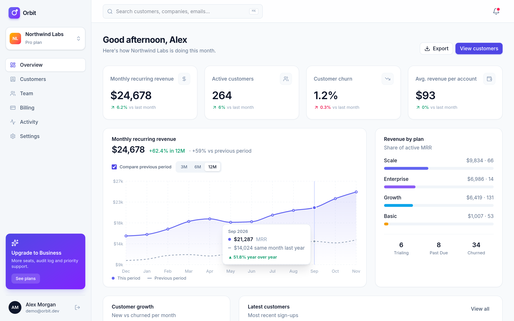
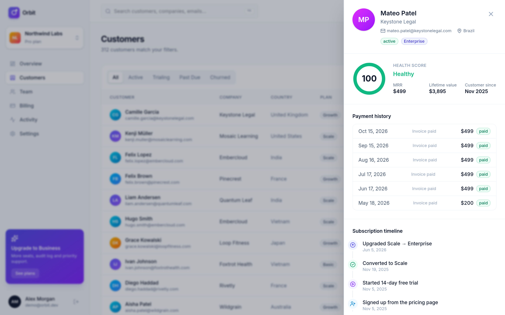
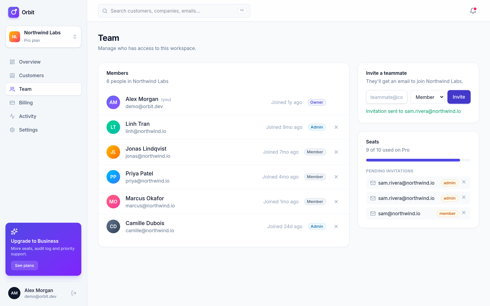
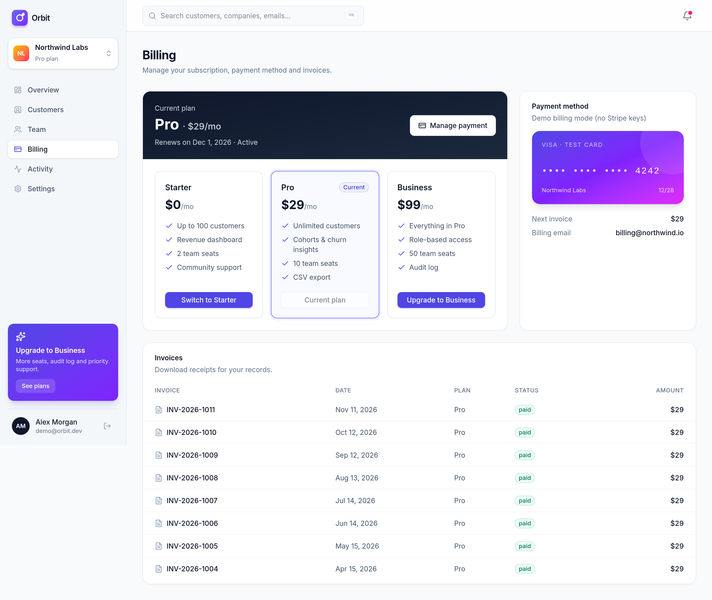
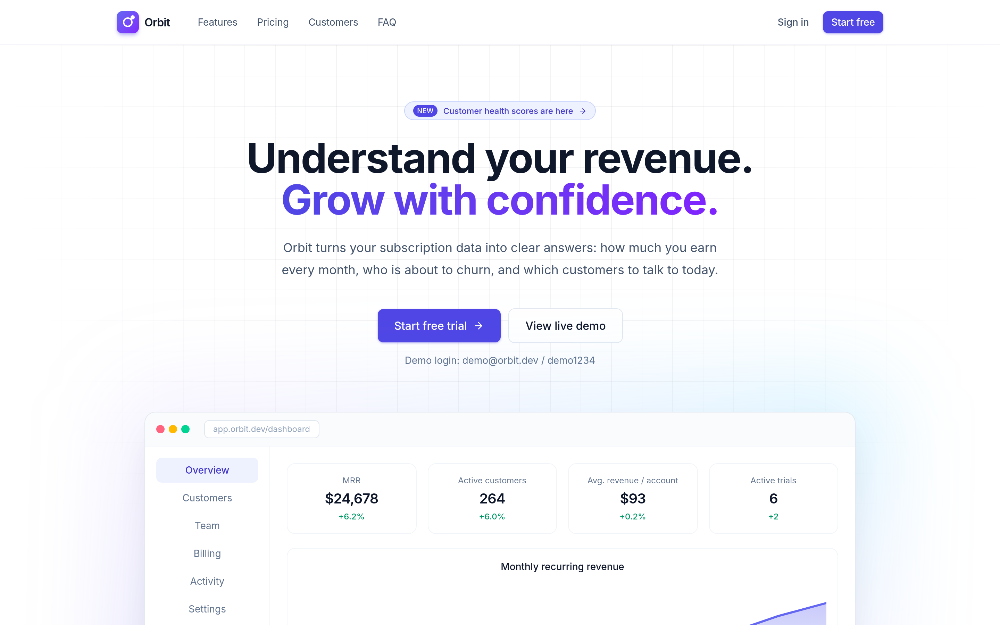

# Orbit — Next.js SaaS Starter

**Launch a subscription SaaS MVP in days, not months.** Orbit is a working revenue-analytics product with auth, teams,
billing, an analytics dashboard and realistic demo data — a foundation you can clone, rebrand and ship.



## Demo

<p align="center"></p>

Full-quality video: [`docs/walkthrough.mp4`](docs/walkthrough.mp4) · Demo login: **demo@orbit.dev / demo1234**

| Customer detail drawer | Team roles & invitations |
| --- | --- |
|  |  |
| **Billing & invoices** | **Landing page** |
|  |  |

More: [customers](docs/screenshots/customers.png) · [activity log](docs/screenshots/activity.png) ·
[settings](docs/screenshots/settings.png) · [pricing](docs/screenshots/pricing.png) · [sign-in](docs/screenshots/sign-in.png) ·
[mobile landing](docs/screenshots/landing-mobile.png) · [full dashboard](docs/screenshots/dashboard-full.png)

## The business problem

Founders who want to validate a SaaS idea spend their first weeks rebuilding the same plumbing: login, workspaces,
roles, Stripe, a dashboard that looks credible to the first customers. Orbit ships that plumbing already wired together
and presented as a real product, so the budget goes into the features that make the idea different.

## Features

| Area | What's included |
| --- | --- |
| **Marketing site** | Customer-focused landing page (hero, product preview, benefits, pricing, testimonials, FAQ, CTA), pricing page, responsive to mobile |
| **Auth** | Email/password sign-up & sign-in, bcrypt hashing, signed JWT session cookie (`jose`), middleware route protection, safe `?next=` redirects |
| **Teams & roles** | Workspaces with Owner / Admin / Member, invitations, seat limits per plan, member removal |
| **Billing** | Stripe Checkout + customer portal + signed webhook. **Demo billing mode** without Stripe keys, so the whole flow works offline; invoice history |
| **Revenue dashboard** | MRR, active customers, churn and ARPA with month-over-month deltas; MRR chart with 3M / 6M / 12M ranges, previous-period comparison, grid and year-over-year tooltip; growth chart; revenue by plan |
| **Customers** | Server-side search, status filters, pagination, health column, and a **detail drawer** with avatar, health score, LTV, payment history and subscription timeline |
| **Activity log** | Audit trail of plan changes, invitations and settings updates |
| **Quality** | TypeScript strict, Vitest unit tests, Playwright smoke test, reproducible screenshot script |

## Results (verified locally)

- `pnpm build` passes (Next.js 15.5, production build)
- **13/13** unit tests pass (plans, sessions, redirects, health score, utils)
- E2E smoke test passes: anonymous redirect → sign-up → empty state → invite → seat limit → upgrade (demo billing) → activity entry → wrong-password rejection
- Seeded workspace: 312 customers, 24 months of metrics with realistic variance, payment history and lifecycle events

## Architecture

| Layer | Choice |
| --- | --- |
| Framework | Next.js 15 App Router, React 19 server components + server actions |
| UI | Tailwind CSS v4, Lucide icons, Recharts |
| Data | **Drizzle ORM + SQLite** (`better-sqlite3`, zero setup). **Postgres is optional**: the schema is portable, but switching to Neon/Supabase means changing the Drizzle driver and running migrations — not done in this repo |
| Auth | JWT cookie via `jose`, bcrypt passwords, middleware guard |
| Payments | Stripe SDK (optional) with webhook; demo mode when keys are absent |

```
src/app/(auth)/            sign-in, sign-up
src/app/dashboard/         overview, customers (+ drawer), team, billing, activity, settings
src/app/api/stripe/webhook signed Stripe webhook
src/lib/db/                Drizzle schema + idempotent SQLite bootstrap
src/lib/auth/              JWT session, password hashing, current user/team guard
src/lib/actions/           server actions (auth, team, billing, settings)
src/lib/queries.ts         typed dashboard queries
src/lib/health.ts          customer health score
scripts/seed.ts            deterministic demo data
scripts/smoke.mjs          end-to-end smoke test (Playwright)
scripts/screenshots.mjs    regenerates docs/screenshots
```

## Quick start & tests

```bash
pnpm install
pnpm db:seed      # creates data/app.db with the demo workspace
pnpm dev          # http://localhost:3000
```

| Command | Description |
| --- | --- |
| `pnpm build && pnpm start` | production run |
| `pnpm test` | unit tests |
| `pnpm smoke` | E2E smoke test against a running server (`APP_URL`, `CHROME_PATH`) |
| `pnpm screenshots` | regenerate README screenshots (`BASE`, `CHROME_PATH`) |

**Stripe (optional, test mode):** copy `.env.example` to `.env.local`, add `STRIPE_SECRET_KEY`, `STRIPE_PRICE_PRO`,
`STRIPE_PRICE_BUSINESS`, then `stripe listen --forward-to localhost:3000/api/stripe/webhook` for `STRIPE_WEBHOOK_SECRET`.

## Limitations & roadmap

- SQLite is ideal for demos and small deployments; use Postgres for multi-instance hosting (driver swap + migrations)
- No email delivery yet — invitations are stored and listed, not emailed (Resend/Postmark integration planned)
- No OAuth / magic-link login yet
- Demo metrics are seeded; connecting real Stripe data to the analytics views is a customization step
- Roadmap: Postgres adapter, email invites, OAuth, usage-based billing, CSV export

## Credits & license

Architecture inspired by [nextjs/saas-starter](https://github.com/nextjs/saas-starter) (MIT) — this is an independent
implementation. Icons by [Lucide](https://lucide.dev) (ISC), charts by [Recharts](https://recharts.org) (MIT).
All names and companies in the demo data are fictional.

MIT © Tran Cong Tien

---

**Need your SaaS MVP built — auth, payments, dashboard, ready for your first customers?**
Hire me on Fiverr: [fiverr.com/optimus2003](https://www.fiverr.com/optimus2003)
