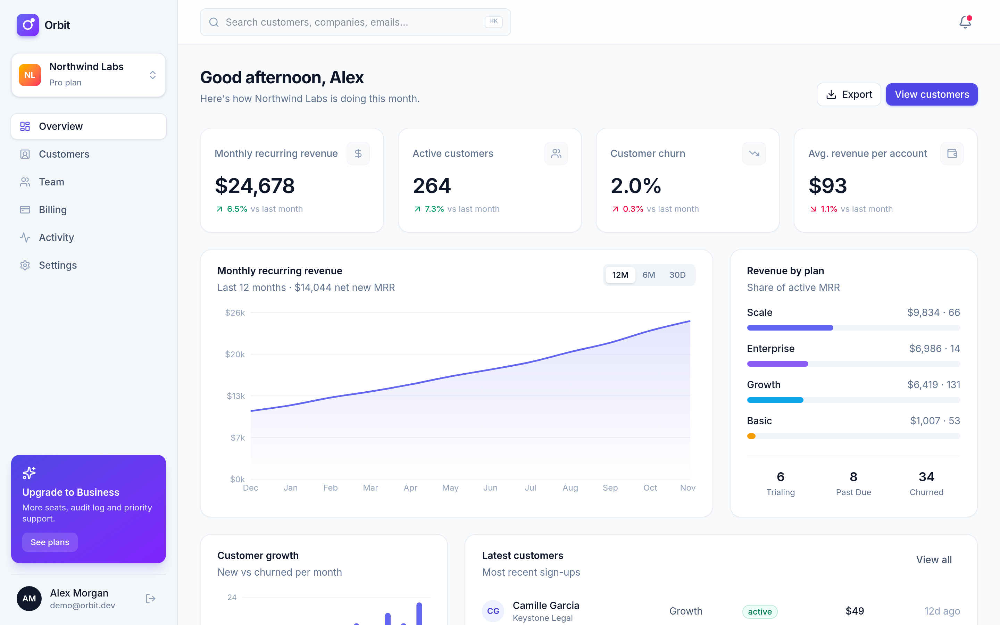
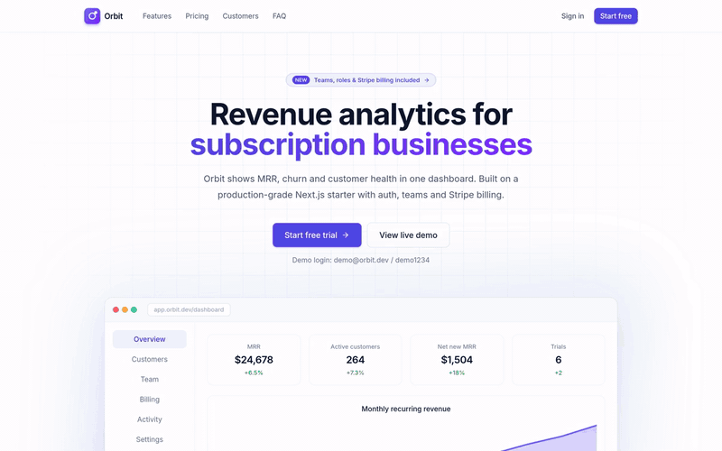
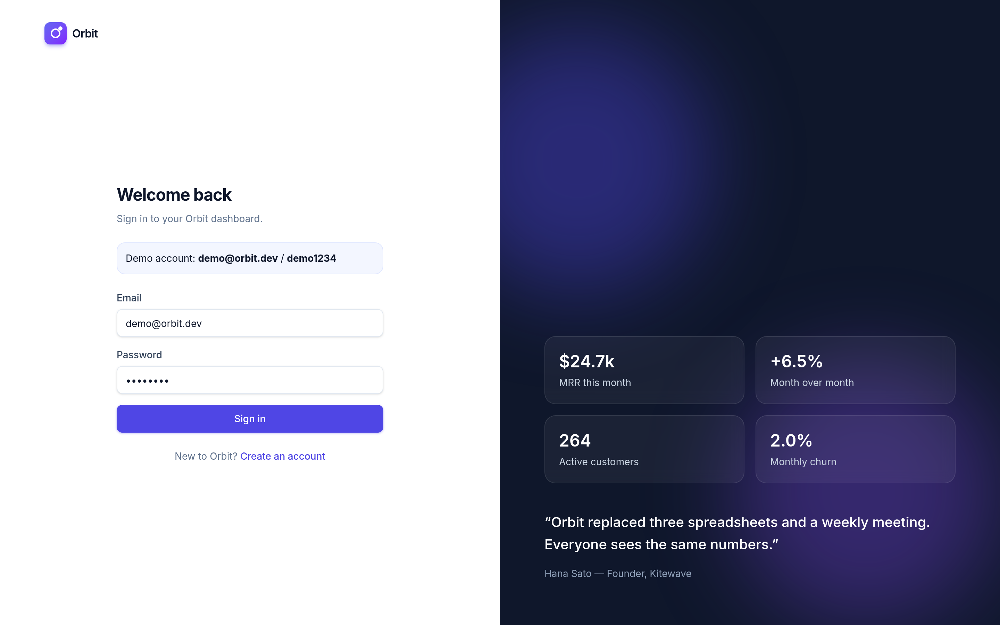
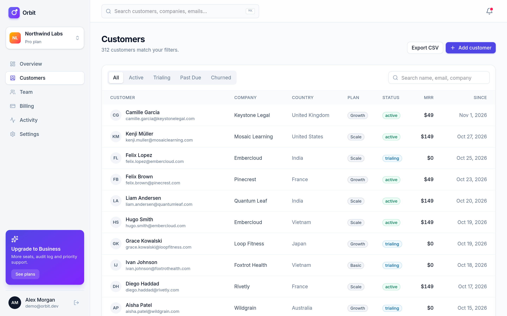
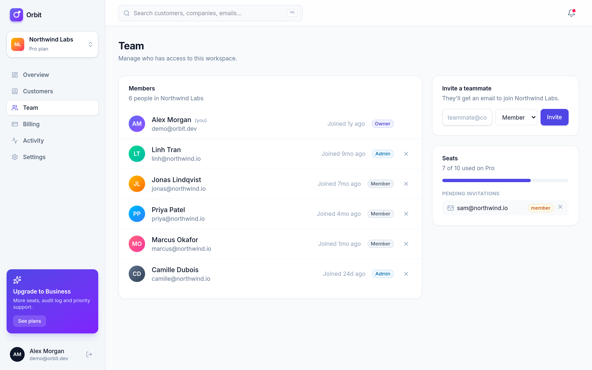
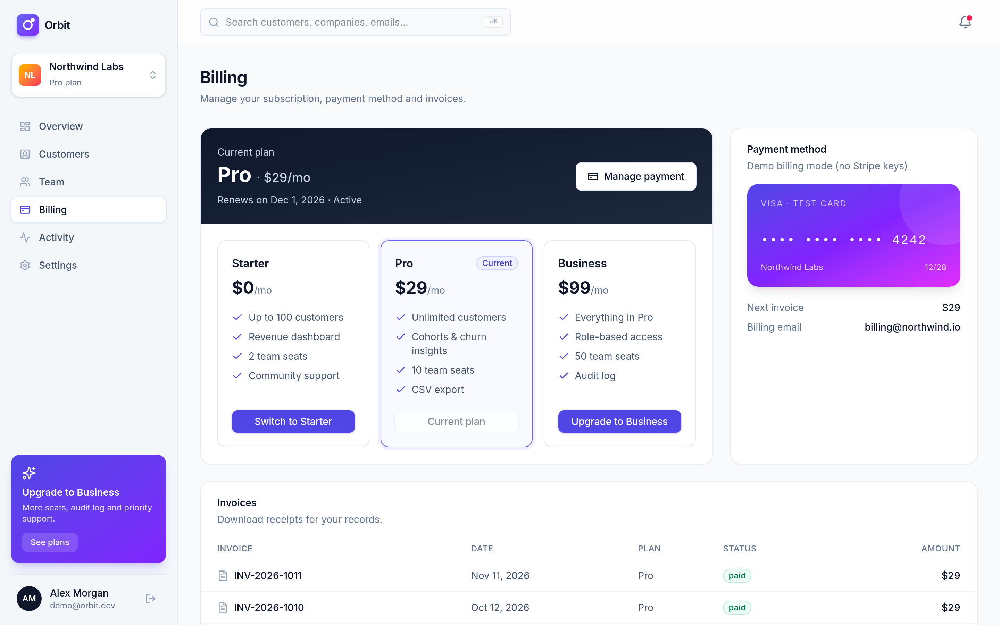
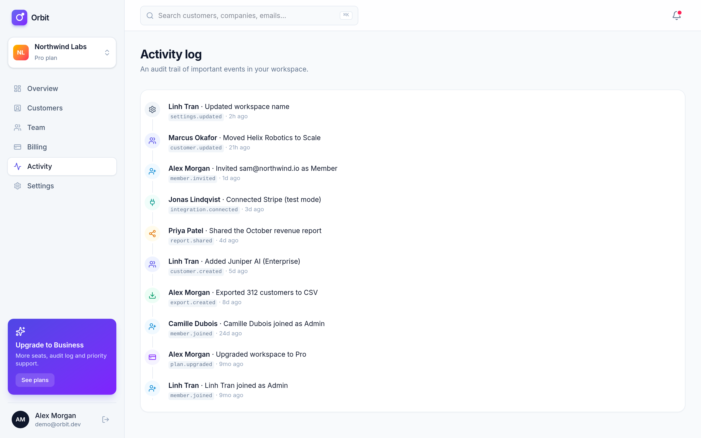
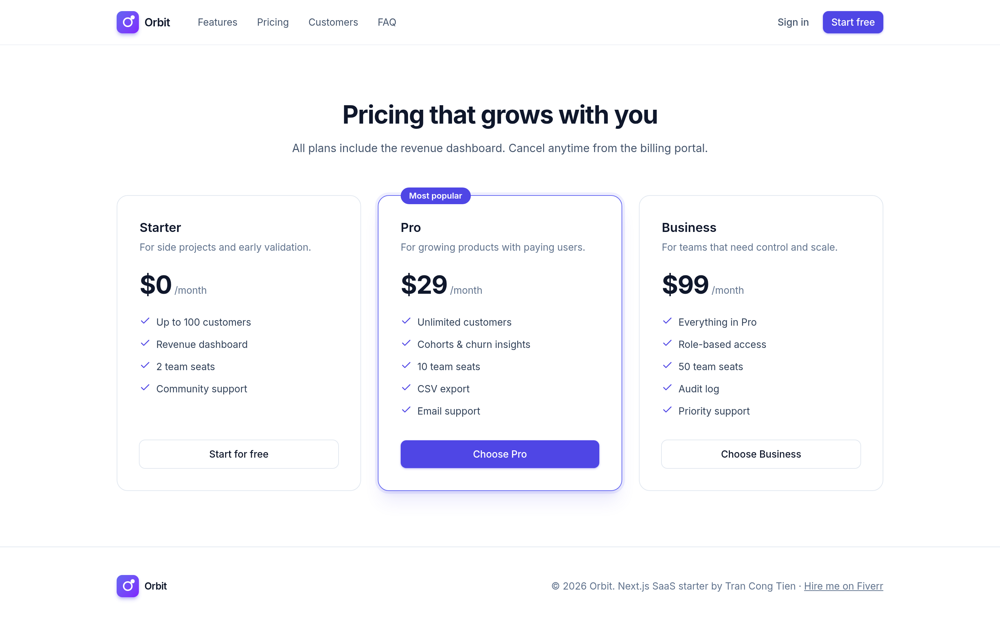
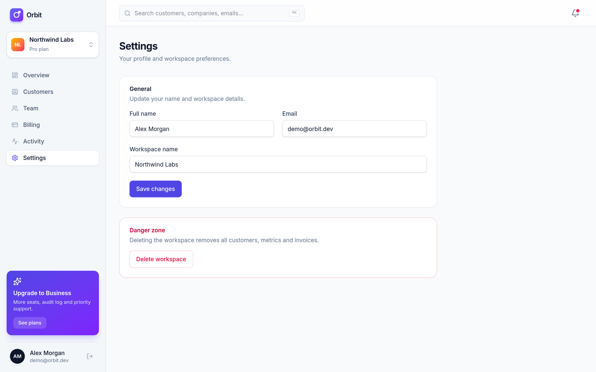

# Orbit — Next.js SaaS Starter

A production-style **SaaS MVP foundation** built with Next.js 15, React 19, Drizzle ORM and Stripe, shown as a
working product: *Orbit*, a revenue-analytics app for subscription businesses. Clone it, run two commands, and you
have auth, teams, billing, an analytics dashboard and seeded demo data running locally.



<p align="center"></p>

## Features

| Area | What's included |
| --- | --- |
| **Marketing site** | Landing page (hero, product preview, features, pricing, testimonials, FAQ, CTA), pricing page, responsive down to mobile |
| **Auth** | Email/password sign-up & sign-in, bcrypt hashing, signed JWT session cookie (`jose`), middleware route protection, safe `?next=` redirects |
| **Teams & roles** | Workspaces with Owner / Admin / Member, invitations, seat limits per plan, member removal |
| **Billing** | Stripe Checkout + customer portal + signed webhook (`/api/stripe/webhook`). **Demo billing mode** when no Stripe keys are set, so the full flow works offline |
| **Dashboard** | MRR, active customers, churn, ARPA with month-over-month deltas, 12-month MRR chart, growth chart, revenue by plan, latest customers |
| **Customers** | Server-side search, status filters and pagination over 312 seeded customers |
| **Activity log** | Audit trail of plan changes, invitations, settings updates |
| **Settings** | Profile and workspace rename with server actions + form state |
| **Data** | Drizzle ORM on SQLite (zero setup). Schema works with Postgres (Neon/Supabase) by swapping the driver |
| **Quality** | TypeScript strict, Vitest unit tests, Playwright smoke test, reproducible screenshot script |

## Quick start

```bash
pnpm install
pnpm db:seed      # creates data/app.db with a realistic demo workspace
pnpm dev          # http://localhost:3000
```

Sign in with **demo@orbit.dev / demo1234** (workspace *Northwind Labs*, Pro plan, 312 customers, 12 months of metrics),
or create a new account to see the empty state and the Starter plan limits.

### Stripe (optional, test mode)

```bash
cp .env.example .env.local
# STRIPE_SECRET_KEY=sk_test_..., STRIPE_PRICE_PRO=price_..., STRIPE_PRICE_BUSINESS=price_...
stripe listen --forward-to localhost:3000/api/stripe/webhook   # gives STRIPE_WEBHOOK_SECRET
```

With keys present, "Upgrade" buttons go to Stripe Checkout and the webhook updates the workspace plan. Without keys,
plan changes apply instantly and generate a paid invoice (demo mode).

## Screenshots

| Landing | Sign in |
| --- | --- |
|  |  |
| **Customers** (search, filters, pagination) | **Team** (roles, invitations, seats) |
|  |  |
| **Billing** (plans, payment method, invoices) | **Activity log** |
|  |  |
| **Pricing** | **Settings** |
|  |  |

Mobile landing: [`docs/screenshots/landing-mobile.png`](docs/screenshots/landing-mobile.png) · Full landing page: [`docs/screenshots/landing-full.png`](docs/screenshots/landing-full.png)

## Project structure

```
src/app/(auth)/            sign-in, sign-up (split layout)
src/app/dashboard/         overview, customers, team, billing, activity, settings
src/app/api/stripe/webhook signed Stripe webhook
src/lib/db/                Drizzle schema + idempotent SQLite bootstrap
src/lib/auth/              JWT session, password hashing, current user/team guard
src/lib/actions/           server actions (auth, team, billing, settings)
src/lib/queries.ts         typed dashboard queries
src/lib/plans.ts           single source of truth for plans, seats and prices
scripts/seed.ts            deterministic demo data
scripts/smoke.mjs          end-to-end smoke test (Playwright)
scripts/screenshots.mjs    regenerates docs/screenshots
```

## Scripts

| Command | Description |
| --- | --- |
| `pnpm dev` / `pnpm build && pnpm start` | run the app |
| `pnpm db:seed` | reset and seed the SQLite database |
| `pnpm test` | unit tests (plans, sessions, redirects, utils) |
| `pnpm smoke` | E2E smoke test against a running server (`APP_URL`, `CHROME_PATH`) |
| `pnpm screenshots` | regenerate README screenshots |

## Verified locally

`pnpm build` passes, 9/9 unit tests pass, and the smoke test covers: anonymous redirect → sign-up → empty state →
invite teammate → Starter seat limit → upgrade to Business (demo billing) → activity log entry → wrong-password rejection.

## Credits

Architecture inspired by the official [nextjs/saas-starter](https://github.com/nextjs/saas-starter) (MIT) — this is an
independent implementation with SQLite, demo billing mode, analytics views and seeded data. Icons by
[Lucide](https://lucide.dev) (ISC), charts by [Recharts](https://recharts.org) (MIT). All names and companies in the demo data are fictional.

## License

MIT © Tran Cong Tien

---

**Need your SaaS MVP built on this stack — auth, payments, dashboard, deployed?**
Hire me on Fiverr: [fiverr.com/optimus2003](https://www.fiverr.com/optimus2003)
